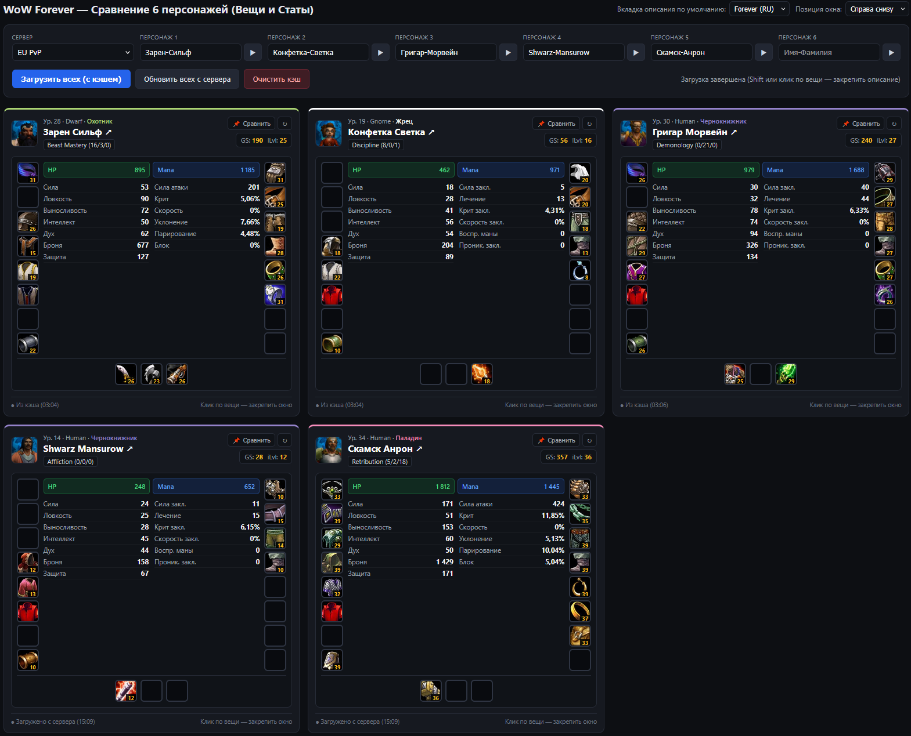

# NoOverlevel-Armory

[](https://python.org)
[](https://github.com)
[](LICENSE)

**[English](#english) | [Русский](#русский)**



---

<a name="english"></a>
## 🇬🇧 English

**NoOverlevel-Armory** is a lightweight cross-platform web dashboard and local proxy server for tracking and comparing up to **6 World of Warcraft characters** side-by-side on the **WoW Forever** private server.

Originally built to keep a friendly eye on squadmates (and make sure that one impatient friend keeps their promise *not to overlevel* while you're offline), it gives you an instant overview of levels, gear, GearScore, and stats in one window.

### ✨ Features
* **Compare 6 Characters Side-by-Side:** Load up to 6 characters across realms (`EU PvP`, `EU PvE`, `US PvP`) and monitor their levels, GearScore (GS), average iLvl, and stats simultaneously.
* **Paperdoll View:** Visual layout of all equipment slots with item icons and item levels around character attributes.
* **Interactive Multi-Database Tooltips:** Hover over any item to view its description in `Forever RU/EN`, `Classic RU/EN`, `TBC RU`, or `WotLK RU`.
* **Slot-by-Slot Stat Comparison:** Click (or `Shift`-click) an item to pin its tooltip. Hovering over the same slot on another character highlights the stat difference.
* **Smart Caching:** Multi-tier local caching (`.armory_cache`) for instant reloads, plus one-click cache clearing and forced server refresh.
* **Zero External Dependencies & SSRF Protection:** Built purely on the Python 3 standard library (`no pip install` needed) with a strict domain whitelist and private IP filtering on the proxy backend.

### 🚀 Installation & Launch

#### Requirements
* **Python 3.8+** (on Windows, make sure to check **"Add Python to PATH"** during installation).
* Any modern web browser.

#### Launching the App

* **Windows:**
  Double-click `start.bat` — it will verify Python, start `server-v8.py`, and open `http://127.0.0` in your browser automatically.

* **Linux / macOS:**
  Open a terminal in the project folder and run:
  ```bash
  python3 server-v8.py
  ```
  Then open `http://127.0.0` in your browser if it doesn't launch automatically.

> **Tip:** Press `Ctrl + C` in the terminal (or close the console window) to stop the server.

### ⚙️ Configuration (`config.py`)
Edit `config.py` to customize your tracked squad, default tooltip language, dock position, or server port:

```python
PORT = 8080  # Or override via ARMORY_PORT env variable

DEFAULT_CHARACTERS = [
    "Зарен-Сильф",
    "Конфетка-Светка",
    "Григар-Морвейн",
    "Shwarz-Mansurow",
    "Скамск-Анрон",
    "Герыч-Херыч"
]

DEFAULT_SOURCE = "forever_ru"  # forever_ru, forever_en, classic_ru, classic_en, tbc_ru, wotlk_ru
DEFAULT_DOCK_POS = "right"     # "right" or "left"
CACHE_TTL_SECONDS = 0          # 0 = keep cache forever until cleared
```

### 📁 Project Structure
* `server-v8.py` — Multi-threaded HTTP server, API & Wowhead proxy, and local JSON cache manager.
* `config.py` — Server port, security whitelist, and default UI/character settings.
* `armory6-v*.html` — Frontend single-page dashboard (the server automatically serves the latest version).
* `start.bat` — One-click Windows launcher script.

---

<a name="русский"></a>
## 🇷🇺 Русский

**NoOverlevel-Armory** — это легковесный кроссплатформенный локальный веб-дашборд и прокси-сервер для отслеживания и сравнения до **6 персонажей World of Warcraft** в одном окне на приватном сервере **WoW Forever**.

Изначально инструмент создавался, чтобы следить за прогрессом друзей по пачке (и вовремя ловить того самого торопыгу, который клялся *«больше не перекачиваться»*, пока остальные офлайн), а также удобно сравнивать экипировку, уровень предметов и статы.

### ✨ Возможности
* **Сравнение 6 персонажей в одном окне:** Загружайте до 6 персонажей с разных миров (`EU PvP`, `EU PvE`, `US PvP`) и следите за их уровнем, GearScore (GS), средним iLvl и характеристиками одновременно.
* **Папердолл (Paperdoll):** Наглядное отображение всех слотов экипировки с иконками и уровнем предметов вокруг характеристик персонажа.
* **Интерактивные тултипы:** Наведите курсор на любой предмет, чтобы увидеть его описание из выбранной базы (`Forever RU/EN`, `Classic RU/EN`, `TBC RU`, `WotLK RU`).
* **Сравнение слотов с разницей статов:** Нажмите на предмет (или удерживайте `Shift`), чтобы закрепить его описание. При наведении на тот же слот у другого персонажа отобразится разница характеристик.
* **Умное кэширование:** Многоуровневый локальный кэш (`.armory_cache`) для мгновенной загрузки, а также очистка кэша и принудительное обновление с сервера в один клик.
* **Без сторонних библиотек и защита от SSRF:** Работает на стандартной библиотеке Python 3 без `pip install`, а прокси-сервер использует строгий белый список доменов и фильтрацию приватных IP.

### 🚀 Установка и запуск

#### Требования
* **Python 3.8+** (при установке на Windows обязательно поставьте галочку **«Add Python to PATH»**).
* Любой современный браузер.

#### Запуск приложения

* **Windows:**
  Дважды кликните по файлу `start.bat` — скрипт проверит Python, запустит `server-v8.py` и сам откроет `http://127.0.0` в браузере.

* **Linux / macOS:**
  Откройте терминал в папке проекта и выполните:
  ```bash
  python3 server-v8.py
  ```
  Если вкладка не открылась сама, перейдите по адресу `http://127.0.0` в браузере.

> **Совет:** Чтобы остановить сервер, нажмите `Ctrl + C` в терминале или просто закройте окно консоли.

### ⚙️ Настройка (`config.py`)
Отредактируйте `config.py`, чтобы задать список отслеживаемых персонажей по умолчанию, источник тултипов, позицию окна или порт сервера:

```python
PORT = 8080  # Либо через переменную окружения ARMORY_PORT

DEFAULT_CHARACTERS = [
    "Зарен-Сильф",
    "Конфетка-Светка",
    "Григар-Морвейн",
    "Shwarz-Mansurow",
    "Скамск-Анрон",
    "Герыч-Херыч"
]

DEFAULT_SOURCE = "forever_ru"  # forever_ru, forever_en, classic_ru, classic_en, tbc_ru, wotlk_ru
DEFAULT_DOCK_POS = "right"     # "right" или "left"
CACHE_TTL_SECONDS = 0          # 0 = хранить кэш бессрочно до ручной очистки
```

### 📁 Структура проекта
* `server-v8.py` — Многопоточный HTTP-сервер, прокси для API Оружейной и Wowhead, менеджер локального кэша.
* `config.py` — Настройки порта, вайтлист доменов и персонажи по умолчанию.
* `armory6-v*.html` — Веб-интерфейс приложения (сервер автоматически находит и отдаёт самую новую версию).
* `start.bat` — Скрипт быстрого запуска для Windows.

---
**Author / Автор:** [Zalmat](https://github.com)  
**License / Лицензия:** [MIT](LICENSE)
